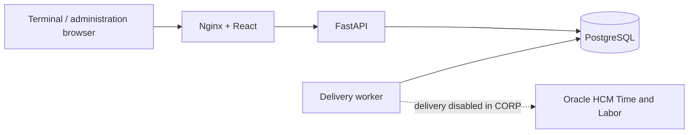

# BSS Time Collection — CORP

Factory attendance capture for **Oracle HCM Time and Labor**, deployed on the
CORP server. BSS acts as an **External Time Collection Device (TCD)**: it captures
attendance facts, persists them in PostgreSQL, and provides auditable asynchronous
delivery to Oracle. Oracle remains the functional system of record.

[Corporate GitLab repository](https://git.hut.chem.corp.local/A0H84018/bss_timecollection_corp)
· Operational branch: **`corp`**
· [CORP deployment guide](docs/corp-deployment.md)

## Current CORP configuration

| Setting | Validated value |
| --- | --- |
| Deployment directory | `/opt/BSSTimeCollection` |
| Public application port | `8080`, configurable through `WEB_PORT` |
| Oracle delivery | Disabled: `ORACLE_ENABLED=false` |
| Automatic demo seeding | Disabled: `APP_SEED_DEFAULTS=false` |
| PostgreSQL image | `postgres:16.4-alpine` |
| API / worker base image | `python:3.12-slim` |
| Frontend build image | `node:22-bookworm-slim` |
| Frontend runtime image | `nginx:alpine` |
| Corporate proxy | Build arguments inherited from the host shell |
| Runtime proxy | None by default |

The `corp` branch preserves the validated corporate deployment configuration.
GitHub application history is retained in this repository. Deployment-specific
changes must remain on `corp`; do not merge them into application `main`.

## Features and boundaries

- Browser provisioning through a one-time activation link or temporary pairing code.
- Per-terminal identification modes: `KEYPAD`, `RFID`, or `BOTH`.
- Touch-friendly numeric keypad, configurable exit actions and sub-actions.
- Local ENTER/EXIT state shared across terminals to simplify capture.
- Global exit restrictions with per-terminal overrides and configurable work cells.
- PostgreSQL event storage with immutable terminal, action and Oracle attribute snapshots.
- Separate transmission history, retry state and historical request/response payloads.
- Administration pages for badge status, event logs, transmission logs and configuration.
- Local action illustrations and Hutchinson BSS branding packaged in the web image.
- Browser-local interface languages: English, Spanish, French and Polish.
  API messages and event labels remain in English.
- A live 24-hour terminal clock; successful capture briefly shows the timestamp
  returned by the API in the browser's local timezone.

Physical RFID reader integration remains pending. RFID mode currently displays
its card illustration and a hardware integration notice; selecting the mode does
not install or configure a reader.

BSS does not calculate worked hours, shifts, overtime, payroll or authoritative
attendance. Employee master data, schedules, approvals, time cards, missing-punch
correction and functional IN/OUT processing belong to Oracle.

## Architecture



| Service | Responsibility |
| --- | --- |
| `web` | Serves the React interface and proxies `/api` to the API |
| `api` | Validates configuration and terminal sessions; persists captures |
| `db` | Stores terminals, actions, policies, pairing, events and transmission attempts |
| `worker` | Independently delivers pending events when Oracle is enabled |

Only `web` exposes a host port by default. Events are committed before capture
success is returned. Oracle unavailability does not prevent capture while local
persistence is available. PostgreSQL advisory locks serialize capture per badge
across terminals, preventing duplicate concurrent entry or exit records.

## Application URLs

Replace `CORP_HOST` with the deployment hostname or address.

| Page | URL |
| --- | --- |
| Terminal / browser pairing | `http://CORP_HOST:8080/terminal` |
| Administration | `http://CORP_HOST:8080/admin` |
| Badge status | `http://CORP_HOST:8080/admin/cards` |
| Event logs | `http://CORP_HOST:8080/admin/events` |
| Transmission logs | `http://CORP_HOST:8080/admin/attempts` |
| Terminals | `http://CORP_HOST:8080/admin/terminals` |
| Actions / Sub-actions | `http://CORP_HOST:8080/admin/actions` |
| Global exit policy | `http://CORP_HOST:8080/admin/policies` |
| Database diagnostics | `http://CORP_HOST:8080/admin/database` |
| Readiness | `http://CORP_HOST:8080/api/v1/health/ready` |

Terminal identity is resolved from the browser session, rather than a terminal
code in the URL. The operational terminal URL is `/terminal`.

## Terminal provisioning and capture

Create or edit a terminal in Administration, assign its actions, and provision
its intended browser using either:

1. **Activation link:** generate a one-time link and open it in the terminal
   browser. Its token is carried in a URL fragment, consumed once, and removed
   from the address bar after activation.
2. **Pairing code:** open `/terminal` in an unprovisioned browser, then approve
   its temporary code for the intended terminal in Administration.

The API sets a `bss_terminal_session` cookie with `HttpOnly` and
`SameSite=Strict`. PostgreSQL stores only its `session_token_hash`. Reprovisioning
revokes the previous session. Normal rebuilds and container recreation preserve
provisioning when the browser cookie and existing database volumes are retained.
For HTTPS deployments, set `TERMINAL_COOKIE_SECURE=true`; local HTTP uses `false`.

When the latest local event is EXIT, or there is no event, scanning records the
configured entry action. When the latest event is ENTER, scanning offers exit
reasons. **Factory exit** opens a second-level menu; only the final sub-action
records an event. Legacy direct MEDICAL assignments remain supported.

An active terminal requires exactly one active ENTER action and at least one
usable EXIT action. Parent exit menus require an active assigned sub-action.
Incomplete configurations can be saved as inactive drafts.

**Clone** copies configuration and action assignments, with new unique identifiers;
it does not copy sessions, tokens or history. Provision the clone separately.
**Remove** performs a logical deletion and revokes access while retaining event
history and reserving terminal codes/device IDs.

## Actions, policies and monitoring

Actions and sub-actions are database configuration. Their stable codes, supplier
event codes, labels, order, availability, hierarchy and optional visual keys are
editable in Administration. Changes affect future events; historical snapshots
remain intact. The seven PNG illustrations live in
`frontend/public/action-visuals/` and require no external image service.

`migration/actions-prod.json` is a versioned action configuration package. It is
not automatically imported at startup; publishing or checking out the repository
does not replace the current CORP actions.

Exit policies are capture restrictions, independent of Oracle attendance rules:

| Mode | Behavior |
| --- | --- |
| `DISABLED` | Any active terminal can capture an exit; default global fallback |
| `SAME_TERMINAL` | The exit must use the terminal of the latest entry |
| `SAME_WORK_CELL` | Both terminals must have the same valid current `work_cell` |
| `INHERIT` | Terminal uses the global mode; available as a terminal override choice |

Global settings belong to **Policies**. Individual overrides and work cells belong
to **Terminals → Edit → Exit policy**. Work cells are trimmed, case-sensitive
strings up to 64 characters. Scan and final exit capture both revalidate policy;
rejection returns HTTP 409 and creates no event or Oracle transmission attempt.

Monitoring provides server-side filters, pagination, manual refresh and automatic
refresh every 15 seconds. Badge state is computed across all terminals before
filtering. Dates display in the browser's timezone; identifiers preserve leading
zeros. The event inspector distinguishes the current Oracle payload preview from
actual persisted transmission payloads.

## Oracle delivery

Oracle is disabled in CORP. Enable it only after the tenant URL, authentication,
source ID and supplier mappings have been validated with the Oracle team.
The adapter sends one local event per `timeEventRequests` request.

| Status | Meaning |
| --- | --- |
| `PENDING` | Captured locally; waiting for delivery |
| `SENDING` | Claimed by the worker |
| `RETRY` | Eligible for retry after a transient failure |
| `SENT` | HTTP transport accepted by Oracle; not downstream functional validation |
| `REJECTED` | Non-retryable response; requires deliberate correction |
| `UNKNOWN` | Ambiguous delivery outcome; requires reconciliation before replay |

Ambiguous read/write timeouts are retained as `UNKNOWN` instead of blindly
replayed. Transmission attempts retain their timing, result, HTTP status and
request/response JSON separately from the captured event.
See the [Oracle contract](docs/oracle-contract.md) for payload details.

## Install a separate instance

Prerequisites: Git, Docker Engine with Compose v2, repository access, and access
to the required images and dependency registries through the approved build proxy.
The following preparation is for a **new instance**, not the running CORP checkout:

```sh
git clone --branch corp git@git.hut.chem.corp.local:A0H84018/bss_timecollection_corp.git
cd bss_timecollection_corp
cp .env.example .env
```

Edit the local `.env`: supply database credentials and a matching `DATABASE_URL`,
set `APP_SEED_DEFAULTS=false` for controlled operation, keep `ORACLE_ENABLED=false`,
and choose `WEB_PORT`. Do not overwrite the existing CORP `.env` or commit secrets.
On an isolated development instance, demo seeding can be enabled deliberately.

API startup runs Alembic migrations and then optional demo bootstrap. With
seeding disabled, create terminals and actions through Administration.
The current schema head is `0008_exit_policies`.

## Build and operate in CORP

The host login shell supplies `HTTP_PROXY`, `HTTPS_PROXY`, `NO_PROXY` and their
lowercase counterparts. Compose passes them only as build arguments, and
Dockerfiles declare `ARG` variables. Preserve corporate/private exclusions and
append service names for the build command:

```sh
bash -lc 'cd /opt/BSSTimeCollection &&
  export NO_PROXY="${NO_PROXY:+$NO_PROXY,}api,worker,web,db" &&
  export no_proxy="${no_proxy:+$no_proxy,}api,worker,web,db" &&
  docker compose build'
```

Do not store proxies in `.env`, persist them with Dockerfile `ENV`, or inject
them into API/worker/web runtime containers. Do not change the global Docker
proxy configuration or restart Docker globally.

Before deploying a code change, back up the database and local configuration,
review migrations, and verify the existing volume layout. Deploy only this
project from its established directory so its Compose project identity remains
unchanged:

```sh
cd /opt/BSSTimeCollection
docker compose config --quiet
docker compose up -d
docker compose ps
curl --noproxy '*' -fsS http://127.0.0.1:8080/api/v1/health/ready
curl --noproxy '*' -fsS -o /dev/null -w '%{http_code}\n' http://127.0.0.1:8080/
```

Database, API and web have health checks; the worker is a long-running process
without its own Compose health check. After deployment, also verify empty
runtime proxy variables and compare terminal provisioning/configuration against
a read-only baseline. Avoid printing resolved Compose environments or tokens.

### Preserve the live PostgreSQL volumes

The validated PostgreSQL 16 deployment mounts the named
`bsstimecollection_postgres_data` volume at `/var/lib/postgresql`, and an existing
**anonymous volume** at the actual `PGDATA=/var/lib/postgresql/data`.
The named parent volume alone does not contain the live database.

Normal build and `up -d` recreation retain existing volumes. Never use
`docker compose down -v`, `docker volume rm`, `--renew-anon-volumes` or destructive
database commands. Avoid `docker compose down`: a later `up` does not automatically
reattach the removed container's anonymous data volume. Preserve both mounts;
a layout change requires a separate backed-up migration.

See [CORP deployment](docs/corp-deployment.md) for the durable operational rules.

## Development and validation

Run backend tests in a separate development environment:

```sh
cd backend
python3 -m venv .venv
. .venv/bin/activate
pip install -r requirements.txt
pytest -q
```

Build the frontend with Node.js 22:

```sh
cd frontend
npm install
npm run build
```

PostgreSQL migration/concurrency tests require `POLICY_TEST_DATABASE_URL`
pointing to an isolated database named `bss_policy_test`. Activation concurrency
tests require `IDENTITY_TEST_BASE_URL` pointing to an isolated test API.
Those optional checks are skipped without their test configuration. Never point
capture tests, migration tests or `docs/validate-exit-policies.py` at the running
CORP application during routine repository validation.

The existing `.github/workflows/ci.yml` defines GitHub Actions checks. GitLab does
not execute that workflow; a GitLab CI pipeline is not configured in this repository.

## Security and configuration

Terminal browser binding is implemented. Administration user authentication is
not yet implemented; access currently relies on the trusted deployment boundary.
A future gateway or authentication layer remains a product decision.

Database diagnostics display the connection endpoint without its password.
External connection testing is disabled by default through
`DATABASE_ADMIN_TEST_ENABLED=false`; it does not switch the live primary database.

Keep `.env`, credentials, activation/session/pairing tokens, deployment backups,
logs and database files outside Git. `.env.example` contains configuration
placeholders only. Retention, reconciliation, reader integration and Oracle
production mappings remain explicit pending decisions.

## Repository and documentation

```text
backend/       FastAPI, SQLAlchemy models, Alembic migrations and tests
frontend/      React/TypeScript interface, Nginx configuration and local assets
migration/     Versioned action configuration package
docs/          Architecture, operational guides and validation evidence
```

- [Architecture](docs/architecture.md)
- [Terminal identity and Oracle context](docs/terminal-identity-and-context.md)
- [Exit policies](docs/exit-policies.md)
- [Oracle payload contract](docs/oracle-contract.md)
- [External PostgreSQL](docs/external-database.md)
- [CORP deployment](docs/corp-deployment.md)
- [Current decisions](CURRENT_STATE.md) and [product facts](FACTS.md)
- [Historical journal](MEMORY.md)

The README and CORP operational guide are in English. Historical decision and
validation documents retain their original language and deployment context;
use the current CORP guide for this server's operating procedure.
